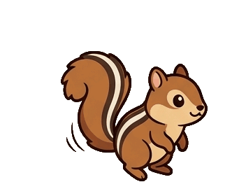
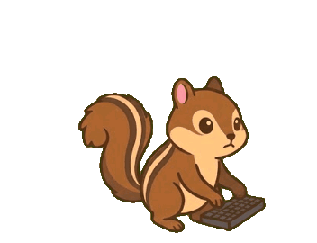
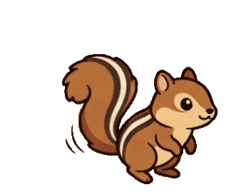
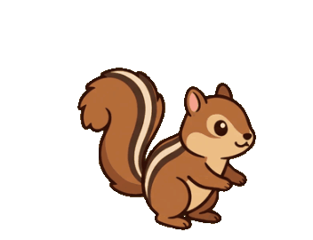
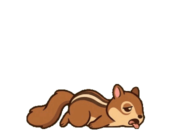
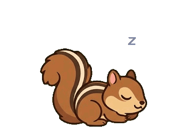
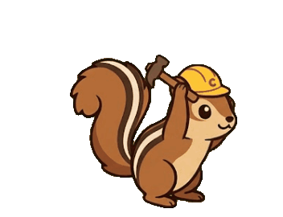
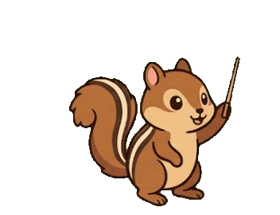
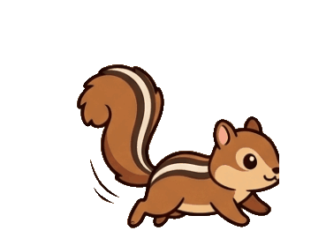

# 🐿️ Squirrel Desk Pet

내 책상에 사는 다람쥐 — [Clawd on Desk](https://github.com/sinnarasam/clawd-on-desk)용 커스텀 테마
A chipmunk desk-pet theme for Clawd on Desk, built with AI-generated art and custom Python compositing.

`AI 생성 아트웍` `GIF 11종` `clawd-on-desk 커스텀 테마` `개인 프로젝트`

   

## 1. 소개

AI 코딩 에이전트(Claude Code 등)의 작업 상태를 데스크톱에서 보여주는 펫 앱 **Clawd on Desk**에는 분홍 게, 삼색 고양이, 구름 캐릭터 테마가 있다. 거기에 줄무늬다람쥐 캐릭터를 하나 더 만들어 넣었다.

- 그림: Gemini로 생성
- 정렬·보정·애니메이션 합성: 직접 작성한 Python 스크립트 (`tools/`)
- 기존 테마의 그림은 전혀 사용하지 않았고, 캐릭터는 새로 기획했다

이런 분께: Clawd on Desk를 쓰고 있고 다른 캐릭터로 바꾸고 싶은 분, 커스텀 테마를 어떻게 만드는지 궁금한 분.

## 2. 상태별 모습

| 상태 | 모습 | 언제 나오나 |
|---|---|---|
| idle |  | 아무 활동이 없을 때 |
| thinking |  | 메시지를 보낸 직후 |
| working |  | 에이전트가 작업 중일 때 |
| attention (Stop) |  | 답변이 끝났을 때 |
| notification |  | 권한 요청이 떴을 때 |
| error |  | 도구 실행이 실패했을 때 |
| sleeping / waking |  | 60초 이상 조용할 때 / 깨어날 때 |
| building / conducting |   | 세션 3개 이상 동시 작업 / 서브에이전트 2개 이상 |
| 드래그 / 자유 배회 |  | 캐릭터를 잡아 끌 때, 화면을 돌아다닐 때 |

## 3. 설치 방법

1. [Clawd on Desk](https://github.com/sinnarasam/clawd-on-desk)를 먼저 설치한다.
2. `theme_squirrel` 폴더 전체를 아래 위치에 `squirrel`이라는 이름으로 복사한다.
   - Windows: `%APPDATA%\clawd-on-desk\themes\squirrel`
3. 앱을 재시작하고, 펫을 우클릭 → `설정` → 테마에서 **Squirrel**을 선택한다.

## 4. 만든 과정 — 묻고, 보고, 고쳤다

처음부터 완성형으로 나온 건 없었다. 몇 가지 예시.

- **에러 모습**: 처음엔 바닥에 엎드려 눈이 X가 되는 연출이었는데, 너무 잔인해 보인다는 의견에 따라 제거했다. 서서 당황하는 표정 → 지쳐서 주저앉는 흐름으로 바꿨다.
- **대기 동작**: 머리를 좌우로 움직이는 효과를 넣었더니 "3D로 좌표를 돌린 것 같다"는 지적을 받아 뺐다. 지금은 꼬리와 호흡만 움직인다.
- **타이핑 동작**: 책상을 코드로 그려 붙였더니 프레임마다 위치가 흔들렸다. 다람쥐 발 높이를 직접 측정해 책상과 키보드를 고정된 자리에 맞췄다.
- **캐릭터 일관성**: 상태별 그림마다 크기와 위치가 제각각이었다. idle을 기준으로 발 위치, 눈 크기, 꼬리 색을 전부 수치로 측정해서 맞췄다.
- **효과음**: 앱 기본 효과음이 거슬린다는 의견에 따라 테마 설정에서 껐다.

## 5. 구조

```
theme_squirrel/        clawd-on-desk에 설치하는 실제 테마
  theme.json              상태·타이밍·반응 설정
  assets/*.gif            상태별 애니메이션 11종 + 드래그 반응
tools/                  제작에 쓴 Python 스크립트
  gem.py                  Gemini 이미지에서 초록 배경 제거·컷 분리
  normalize.py            모든 상태를 idle 기준으로 위치·크기·색 정렬
  states.py, error_*.py   코드로 그린 보조 동작과 효과
```

## 6. 출처와 라이선스

구성 요소마다 권리 관계가 달라 [LICENSE.md](LICENSE.md)에 따로 정리했다. 요약하면 스크립트는 MIT, 그림은 AI 생성(개인용 공개), 기반 앱 [Clawd on Desk](https://github.com/sinnarasam/clawd-on-desk)는 AGPL-3.0이며 이 저장소는 그 앱의 소스 코드를 포함하지 않는다.
